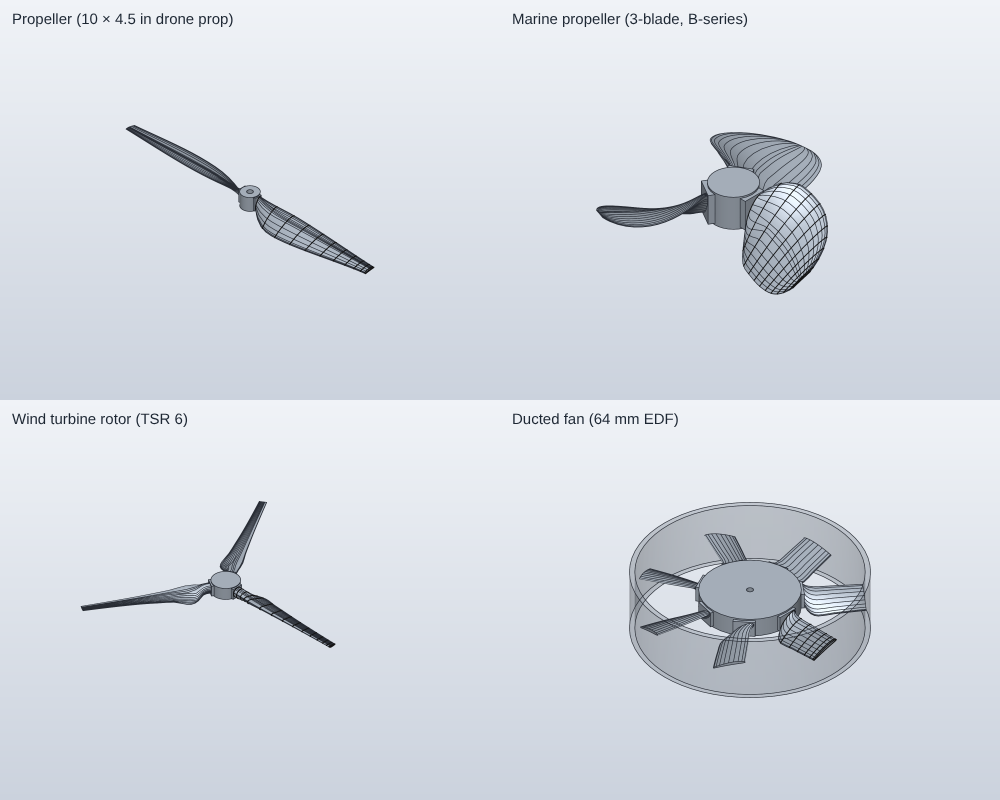
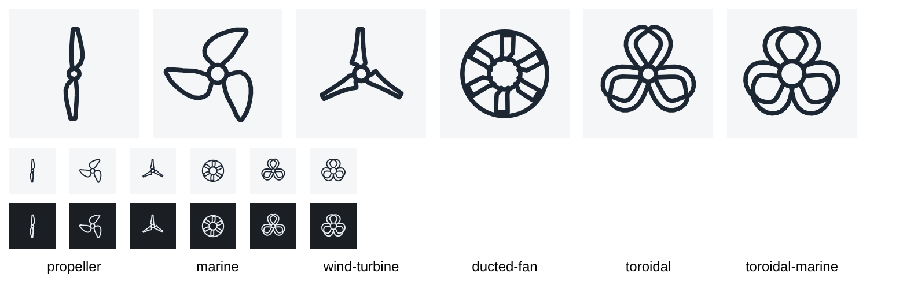
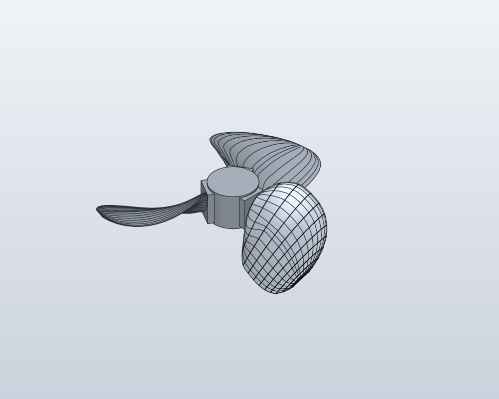
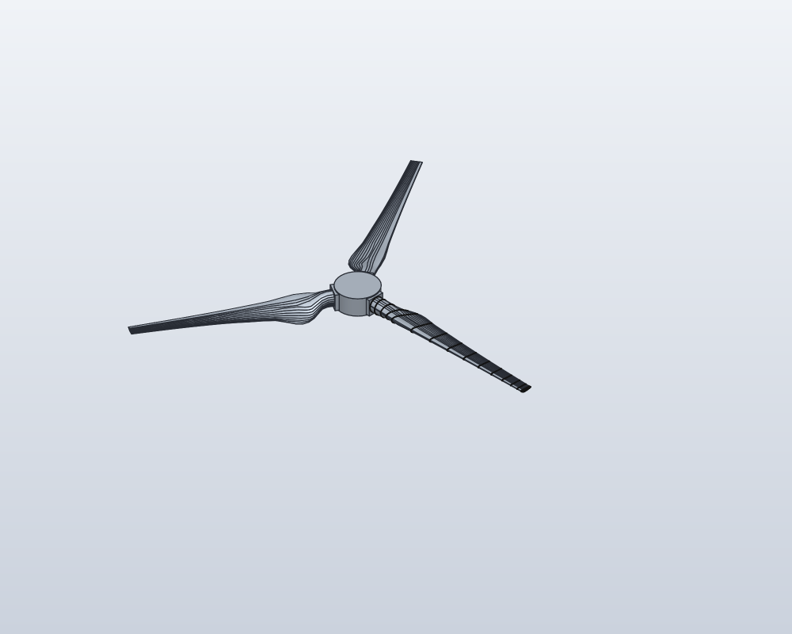
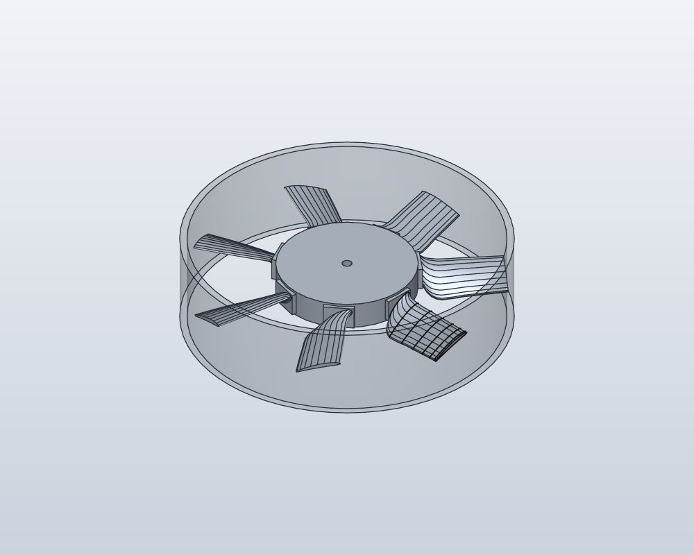
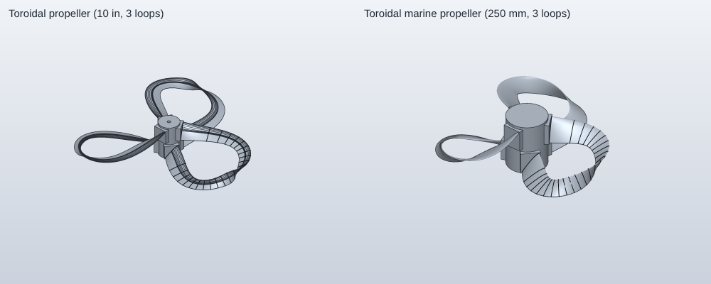

# Propellers: a SolidCraft plugin

Makes propellers and rotors in SolidCraft. It adds six commands to the Plugins group on the
Model tab and to the Plugins menu. You fill in a form; the plugin works out each blade's
airfoil sections from the radius out to the tip, then builds the rotor with ordinary SolidCraft
commands:

| Entry | For | Builds it as |
|---|---|---|
| `propeller` | Drones, RC models, light aircraft | A hub, extruded; one blade, lofted through its airfoil sections onto a root pad; a circular pattern for the other blades |
| `marine` | Outboard and inboard engines, boats, ROV thrusters | The same, with Wageningen B-series blade outline and thickness, skew and rake |
| `wind-turbine` | Small horizontal-axis wind turbines | The same, with blades shaped by Schmitz's optimum and a round root; or one blade on its own |
| `ducted-fan` | EDF units, cooling and blower fans | The same, with many blades, plus a duct ring around the tips as its own body |
| `toroidal` | Quiet drone and fan propellers | Closed loops instead of blades: one loop lofted between two root pads, patterned |
| `toroidal-marine` | Outboards, boats and thrusters with looped blades | The same, with wider loops sized for water |

The result is ordinary editable features (sketches, extrudes, a loft and a circular pattern), so
you can modify it later: change the pattern's count, say, or edit a section sketch. The whole
run is a single undo step. The plugin needs no file, network or settings access.



## Install

**Requires SolidCraft 0.43.0 or later.**

Download `propellers-0.2.0.zip` from the
[latest release](https://github.com/bbonsen/solidcraftPropellerPlugin/releases/latest). In
SolidCraft (desktop), open **Preferences > Plugins > Install plugin…** and pick it. It asks for
no permissions. You can also install it from a script:

```json
[{"command":"plugin.install","params":{"path":"propellers-0.2.0.zip"}}]
```

To upgrade an earlier version by script, add `"replace": true`.

## Command names

| Entry | Title | Ribbon label |
|---|---|---|
| `propeller` | Propeller | Propeller |
| `marine` | Marine propeller | Marine |
| `wind-turbine` | Wind turbine rotor | Wind turbine |
| `ducted-fan` | Ducted fan | Ducted fan |
| `toroidal` | Toroidal propeller | Toroidal |
| `toroidal-marine` | Toroidal marine propeller | Toroidal marine |

As with the [Gears](https://github.com/bbonsen/solidcraftGearsPlugin) plugin, each entry's
`menu` slot names the command and its `ribbon` slot gives the button's label. SolidCraft does
not take plugin icons yet; `icons/` holds one per command for when it does, drawn from the
plugin's own blade planforms (`cargo run --example icons`), in the same style as the Gears
icons: a 64 × 64 view box, 2.55-unit round lines and only `currentColor`.



## Where the rotor lies

- The rotor turns about the **Z axis** through the origin. Blade 1 points along +X.
- A propeller or fan pushes air towards **−Z**, so its thrust points along +Z: +Z is the front.
  A marine propeller going ahead moves towards +Z. A wind turbine faces the wind on its +Z
  side; the wind blows towards −Z.
- The hub is a cylinder centred on the blade roots along Z; the reply gives its extent
  (`hub_z_mm`) and the blades' (`axial_extent_mm`).

## Inputs common to every entry

| Field | Meaning |
|---|---|
| `blades` | Number of blades |
| `diameter` | Tip diameter, mm |
| `hub_diameter` | 0 picks a size for the kind of rotor |
| `hub_length` | 0 makes the hub just long enough to hold the blade roots, with a small margin |
| `bore` | Centre hole diameter, mm. 0 means no hole |
| `rotation` | Which way it turns (see each entry) |
| `trailing_edge` | The thinnest the trailing edge may be, mm. Real trailing edges are nearly sharp; 3D printing and casting need some thickness |
| `sections` | Airfoil sections per blade, 4–40. More follow the blade's shape more closely; the loft gets heavier |
| `section_points` | Points on each side of a section, 6–60 |

Not on the forms, for scripts: `section_curve` is `spline` (the default: one fit-point spline
round the leading edge and a straight line across the trailing edge, so each blade has smooth
faces) or `polyline` (a closed polyline: many narrow faces, but the lightest for the kernel).

### How a blade is drawn

Each section is a NACA 4-digit airfoil: the standard thickness distribution and a mean line with
the given camber. It lies on a plane square to the blade at its radius, turned to the blade
angle, so the result is what a propeller designer would call "planar sections". The sections
are lofted into one blade, and the tip ends in a short flat face at the tip chord.

At the root, the blade starts as a rounded oval shank (the turbine's is round) and blends into
the airfoil over the first eighth or so of the span, as real blades do. The shank stands on a
**root pad**: a small rectangular block from inside the hub to just outside its wall, whose flat
outer face the loft starts on. The pad is there for SolidCraft's kernel: a lofted root crossing
the hub's cylinder is an intersection it often refuses ("extremely small radius of curvature"),
while flat faces crossing it are reliable. The pads stand a few millimetres proud of the hub.

The first blade points along +X; a circular pattern of its pad and its loft about Z makes the
others and joins them to the hub.

The sections are placed on planes rather than wrapped on cylinders; for a narrow blade the
difference is tiny. For very wide blades close to the hub (a marine propeller with a high area
ratio), the true cylindrical section would curve slightly round the hub.

## Propeller (entry `propeller`)

| Field | Default | Meaning |
|---|---|---|
| `blades` | 2 | 2–8 |
| `diameter` | 254 | mm (10 in) |
| `pitch` | 114.3 | Geometric pitch, mm (4.5 in): how far one turn would screw the propeller forward through a solid |
| `rotation` | ccw | Seen from the front, the way the thrust points. Drone props come in pairs: `ccw` and `cw` |
| `hub_diameter` | 0 | 0 = 6% of the diameter, at least the bore + 4 mm |
| `bore` | 5 | mm |
| `root_chord`, `max_chord`, `tip_chord` | 0 | Blade width at the hub, at its widest and at the tip, mm. 0 = 6%, 9% and 3.5% of the diameter |
| `max_chord_at` | 0.35 | Where the blade is widest, as a fraction of the radius |
| `root_thickness`, `tip_thickness` | 0.16, 0.08 | Section thickness as a fraction of the chord, varying linearly from hub to tip |
| `camber` | 4 | % of the chord, at 40% of the chord (`camber_position` in scripts) |
| `rpm` | 0 | Optional: the reply then gives the tip speed and the pitch speed |

The blade angle at each radius r is atan(pitch / 2πr), which gives the same geometric pitch all
along the blade. The reply checks it at 0.75 R, where propellers are usually measured
(`pitch_at_75_mm`).

## Marine propeller (entry `marine`)



| Field | Default | Meaning |
|---|---|---|
| `blades` | 3 | 2–7 |
| `diameter` | 250 | mm |
| `pitch` | 250 | mm. Outboard props are sold as diameter × pitch in inches: 13 × 19 is 330 × 483 mm |
| `rotation` | right | `right` turns clockwise seen from astern when going ahead, as on most outboards; `left` for the other engine of a twin installation |
| `area_ratio` | 0.55 | Expanded blade area / disc area, 0.25–1.2. Higher for heavily loaded props, to avoid cavitation |
| `skew` | 15 | Degrees the blade tip sweeps back, against the direction of rotation; skew grows with the square of the distance from the hub. Skew smooths the blade's entry into the wake and cuts vibration |
| `rake` | 10 | Degrees the blades lean aft. Rake helps a surface-piercing or high-speed prop hold the water |
| `hub_diameter` | 0 | 0 = 20% of the diameter |
| `camber` | 2 | % of the chord, at mid-chord |
| `thickness_scale` | 1 | Multiplies the B-series blade thickness: more for a printed or cast prop that needs to be stronger |

The blade's outline (chord at each radius) and its maximum thickness follow the Wageningen
B-series, the classic systematic series of marine propellers, for the given area ratio. The
chord is greatest at about 0.6 R and rounds off towards the tip like √(1 − r/R); the outline
stops at 0.99 R with a short flat tip. Sections are stacked at mid-chord. Pitch is constant.
The B-series tip is very thin; sections are kept at least 5% thick, since a sharper leading edge
is more than the kernel's checks (or a printer) will take.

## Wind turbine rotor (entry `wind-turbine`)



| Field | Default | Meaning |
|---|---|---|
| `build` | rotor | `rotor` builds the hub and every blade; `blade` builds one blade on its own (no hub), with its round root, to print or mould separately |
| `blades` | 3 | 1–6 |
| `diameter` | 1000 | Rotor diameter, mm |
| `tip_speed_ratio` | 6 | Blade tip speed / wind speed at the design point, 1–15. Three-bladed rotors usually run at 5–8 |
| `design_cl` | 1.0 | The airfoil's lift coefficient at the design angle of attack |
| `angle_of_attack` | 6 | Degrees: the design angle of attack, where the airfoil's lift-to-drag ratio is best |
| `rotation` | cw | Seen from upwind |
| `hub_diameter` | 0 | 0 = 10% of the diameter |
| `root_diameter` | 0 | The round root's diameter, mm; 0 picks one that fits the hub and the first airfoil section |
| `root_transition` | 0.25 | Where the full airfoil begins, as a fraction of the radius |
| `root_thickness`, `tip_thickness` | 0.21, 0.12 | Airfoil thickness at the transition and at the tip |
| `camber` | 4 | % (NACA 44xx-like sections) |
| `wind_speed` | 8 | m/s, only for the reply's design rpm and rough power figure |

Chord and twist follow Schmitz's optimum (Betz's with wake rotation): with
φ₁ = atan(R / (λ·r)), the inflow angle is φ = ⅔ φ₁, the blade angle φ − α, and the chord
16π·r / (B·C_L) · sin²(φ₁/3). This gives the wide, strongly twisted inner blade and the slim
outer blade of a real turbine. Inside `root_transition`, the blade keeps the transition
section's chord and angle and blends smoothly from the airfoil into a round root, which buries
itself in the hub. The reply gives the design rpm, ω = λ·V/R, at `wind_speed`.

## Ducted fan (entry `ducted-fan`)



| Field | Default | Meaning |
|---|---|---|
| `blades` | 7 | 3–12 |
| `diameter` | 64 | Fan (blade tip) diameter, mm: a 64 mm EDF |
| `pitch` | 60 | mm |
| `rotation` | ccw | Seen from the intake (+Z) |
| `hub_diameter` | 0 | 0 = 45% of the diameter |
| `bore` | 2 | mm |
| `root_chord` | 0 | 0 = the chord at which the roots fill 60% of the hub's circumference, seen along the axis |
| `tip_chord` | 0 | 0 = the same as the root chord |
| `root_thickness`, `tip_thickness` | 0.12, 0.08 | |
| `camber` | 4 | % |
| `duct` | true | Build the duct ring, as its own body |
| `tip_clearance` | 0.3 | Gap between the blade tips and the duct, mm |
| `duct_wall` | 1.5 | mm |
| `duct_length` | 0 | 0 = the blades' axial extent plus a margin, at least 0.3 × the diameter |

Fans default to 8 sections of 10 points a side: their blades are short, and it keeps the run
quick.

## Toroidal propellers (entries `toroidal` and `toroidal-marine`)



A toroidal propeller replaces each blade with a closed loop. The loop's **leading arm** leaves the
hub forward (+Z) and ahead in the direction of rotation, runs out to a **tip bridge**, and comes
back to the hub as the **trailing arm**, aft and behind. With no free blade tip, there is no
concentrated tip vortex; such propellers are reported to be markedly quieter in air, and are
sold for boats as well.

| Field | `toroidal` | `toroidal-marine` | Meaning |
|---|---|---|---|
| `loops` | 3 | 3 | 2–8 (air), 2–6 (marine) |
| `diameter` | 254 | 250 | mm, across the loops' outer edges |
| `pitch` | 114.3 | 250 | Geometric pitch, mm |
| `rotation` | ccw | right | As for `propeller` and `marine` respectively |
| `spread` | 0.55 | 0.6 | The angle between a loop's two roots, as a fraction of the spacing between loops (0.2–0.9). Wider makes rounder loops |
| `axial_offset` | 0 | 0 | Axial distance between a loop's two roots, mm. 0 = the root chord |
| `root_chord` | 0 | 0 | mm. 0 = 10% (air) or 15% (marine) of the diameter |
| `tip_chord` | 0 | 0 | Chord across the tip bridge, mm. 0 = 60% of the root chord |
| `root_thickness`, `tip_thickness` | 0.12, 0.1 | 0.12, 0.08 | Fraction of the chord |
| `hub_diameter` | 0 | 0 | 0 = 12% (air) or 24% (marine) of the diameter |
| `bore` | 5 | 0 | mm |
| `sections` | 25 | 25 | Sections round the loop, 9–45 |

`hub_length`, `trailing_edge` and `section_points` work as for the other entries.

How the loop is drawn:

- **The centreline** rises from the hub as √sin(πt) of the way round, so both arms leave the hub
  radially, and moves smoothly from the leading root's angle and axial position to the trailing
  root's. Its outer edge is at the diameter.
- **Each section** is square to the centreline. Its chord takes the blade angle of the pitch,
  atan(pitch / 2πr), scaled by how far the section's width runs along the direction of rotation:
  so on each arm the chord lies at the blade angle with its leading edge towards the direction of
  travel, and across the tip bridge the chord turns through axial. Both arms meet the air leading
  edge first.
- **The sections are symmetric (NACA 00xx).** As the chord turns through axial, the section's
  two faces swap sides: the face on top of the leading arm is underneath on the trailing arm. A
  cambered airfoil would be cambered the wrong way on one of them, so the loop has no `camber`
  input.
- **Both roots stand on root pads**, like the other entries' blades, and the loop is one loft
  joined to the hub between them. A circular pattern of the two pads and the loop makes the
  other loops.

The entry refuses a design whose loop roots would cross: a loop's own two roots (make `spread`
or `axial_offset` larger, or the root chord smaller) or neighbouring loops' roots (make `spread`
smaller or use fewer loops). It does not optimise the loop's shape aerodynamically; the
published designs differ in sweep, loop shape and section, so treat the result as a starting
point to tune and test.

## The reply

Every entry returns the bodies it made, the diameter, hub and bore sizes, the pitch and blade
angle at 0.75 R, the blade area ratio (expanded blade area over disc area), and a table of every
section: radius, chord, blade angle and thickness. Each kind adds its own figures (pitch in
inches, tip speed, design rpm and so on) and notes on rotation. A `warnings` list says when
neighbouring blade roots overlap at the hub.

## Build

```bash
rustup target add wasm32-unknown-unknown
cargo install wasm-tools
./build.sh          # tests, builds the component, writes propellers-0.2.0.zip
```

`host-check/` runs the packaged component inside SolidCraft's real plugin runtime crate
(`craft-plugin-wasm`), using a host that records each command call. It expects a SolidCraft
checkout next to this repository:

```bash
git clone --depth 1 https://github.com/tangency-labs/solidcraft ../solidcraft
cd host-check && cargo run --release
```

`cargo run --example script -- marine '{"blades": 4}' > marine.json` prints the commands an
entry would run as a SolidCraft command script, which `solidcraft-cli run` and
`solidcraft-cli snapshot` take directly. The preview pictures were made that way.

`wit/plugin.wit` is copied unchanged from SolidCraft (`crates/craft-plugin/wit/plugin.wit`,
MIT OR Apache-2.0).

## Status

Tested against SolidCraft 0.43.0's own code, but not yet in the desktop app:

- `host-check` runs the packaged component in SolidCraft's plugin runtime (`craft-plugin-wasm`):
  every entry commits, bad inputs are refused before any command, and the largest settings stay
  within the runtime's limit of 256 host calls per run.
- The packaged plugin was installed (`plugin.install`, dry run) and run (`plugin.run`) by
  SolidCraft's headless CLI against its real kernel: every entry's defaults build closed,
  single-shell solids in 3–6 s.
- 48 randomly chosen designs (12 of each bladed kind, across blade counts, sizes, pitches, area
  ratios, skew, rake, tip speed ratios, rotations, bores and ducts) all build as closed,
  single-shell solids, each in 1–7 s.
- 48 randomly chosen toroidal designs (24 air, 24 marine, across loop counts, sizes, pitches,
  spreads, offsets, thicknesses and rotations): 43 build as closed, single-shell solids in 3–10 s,
  and 5 are refused before any command because their loop roots would cross.

A run must finish within SolidCraft's 30 s plugin deadline, which includes the kernel's work. If a
large or many-bladed rotor runs out of time on a slow computer, lower `sections` or
`section_points`.

## License

[MIT](LICENSE). `wit/plugin.wit` is SolidCraft's plugin interface, copied unchanged and
licensed by its authors under MIT OR Apache-2.0.
